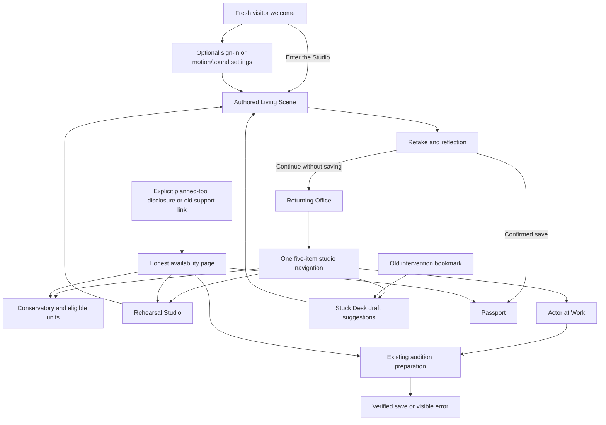

# SLAMS information architecture

`src/routes/__root.tsx` owns the root layout. `AppShell` owns the sole persistent five-item studio bar. `SessionProvider` owns identity, and existing stores own private persistence. Cinematic entry routes intentionally omit the studio bar. Layout-only route files render `Outlet`; they are not additional competing departments.

| Primary destination | Canonical route | Responsibility                                                                                     |
| ------------------- | --------------- | -------------------------------------------------------------------------------------------------- |
| Office              | `/`             | Orientation, physical school books, rehearsal/work/problem-solving entrances, factual current work |
| Schools             | `/conservatory` | Eight-school structure, availability and reviewed-unit entry                                       |
| Rehearse            | `/rehearsal`    | Actual Living Scene and supported saved-history entry                                              |
| Work                | `/work`         | Available audition preparation first; explicit disclosure for planned tools                        |
| Stuck Desk          | `/stuck`        | Existing authored draft interventions and a practical rehearsal action                             |

Supporting record/account destinations remain in the profile menu; Office objects retain contextual support entrances. Matrix now highlights its Conservatory owner rather than losing the primary location state.

## Actual route map

| Routes                                                                   | Owner/status                                                                                               |
| ------------------------------------------------------------------------ | ---------------------------------------------------------------------------------------------------------- |
| `/`, `/welcome`, `/welcome/account`, `/welcome/setup`                    | Office/first-use entry; welcome CTA goes directly to `/scene`; account/settings are optional               |
| `/auth`, `/reset-password`                                               | Existing email auth/recovery                                                                               |
| `/conservatory`                                                          | School selector                                                                                            |
| `/conservatory/$school`                                                  | Existing school tabs/templates                                                                             |
| `/conservatory/$school/years/$year`                                      | Canonical year structure                                                                                   |
| `/conservatory/$school/years/$year/terms/$term`                          | Canonical term structure                                                                                   |
| `/conservatory/$school/units/$kind/$unitId`                              | Course/workshop/lesson/exercise/assessment; only actual eligible reviewed material                         |
| `/rehearsal`, `/scene`                                                   | Rehearsal hub and authored text demonstration                                                              |
| `/work`, `/work/audition`                                                | Working preparation; audition brief/script-status/character/preparation views                              |
| `/work/character`, `/work/breakdown`, `/work/self-tape`, `/work/journal` | Retained availability destinations with a working alternative                                              |
| `/stuck`                                                                 | Canonical draft suggestions; old scene/identify query links remain truthful                                |
| `/stuck/intervention`                                                    | Compatibility redirect to `/stuck?tab=describe`                                                            |
| `/stuck/diagnosis`, `/stuck/retry`, `/stuck/saved`                       | Retained unavailable destinations with a working alternative                                               |
| `/baseline`                                                              | Availability destination; `?flow=welcome` retains the optional introduction outside the default entry path |
| `/lab`, `/matrix`, `/lounge`                                             | Retained support availability destinations                                                                 |
| `/passport`, `/progress`                                                 | Saved reflections and genuine training activity; unsupported evidence/skills remain disclosed              |
| `/director`, `/settings`, `/help`                                        | Existing controls, account/preferences and help                                                            |

Eight canonical school slugs remain `stanislavski`, `meisner`, `adler`, `strasberg`, `chekhov`, `laban`, `practical-aesthetics`, `viewpoints`. The provisional 36-term hierarchy is unchanged.

## Interaction and disposition

PR A removes **no meaningful route or saved record**. It removes 36 empty support-tab controls, the Work hub’s mixed working/planned tab bar, the Stuck intake’s inactive workflow tabs/links, and two duplicate intervention tabs. Old support `?tab=` values are still normalized for compatibility without rendering empty tab interfaces. The intervention route redirects instead of duplicating its content owner. Working audition tabs, school tabs, rehearsal history, settings and record views remain.

Removed unreferenced implementation alternatives: `SystemStub`, modal `OfficeProgress`, `SystemsNav`/`InDev`, and unused six-item-nav/modal-progress CSS. No live second navigation bar was present; the cleanup prevents stale alternatives from competing with the current owners.

PR B removes the compulsory-looking five-step welcome counter and the default account/setup/baseline sequence. No route is removed. The original cookie/legacy-record/session entry decision and existing deep links remain owned by their prior code. Actor-setup storage/schema stays unchanged; the new settings UI no longer asks experience/goals that do not change immediate instruction.
