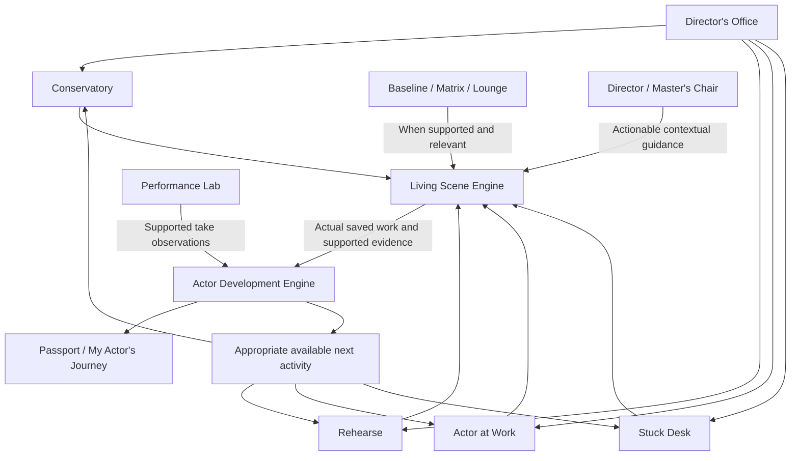

# SLAMS product contract

Brand: **mrahmostudios presents SLAMS — The Actor’s Pocket Studio**. Signature: Scene · Listening · Action · Movement · Stakes.

SLAMS promises purposeful practical acting work with an identifiable Director, reliable personal notes and transparent training availability. Its currently demonstrable value is a complete **authored, text-only rehearsal/retake/reflection** and an **audition-preparation note workflow**. Eight school outlines are a training architecture, not eight complete courses.

## Architecture decision — 2026-11-02

The owner's clarification locks **three primary worlds, six supporting systems, eight schools, ten signature experiences and two shared engines**. Preserve all nine original sections as product responsibilities. Supporting systems and signature experiences appear in context rather than becoming nine or nineteen primary navigation destinations. This clarification extends the execution directive; it does not claim that the complete product is implemented.

The Office visibly leads to **Train, Rehearse, Work and Get Unstuck**. The existing five primary destinations remain **Office, Schools, Rehearse, Work, Stuck Desk**. Office is the home/orientation environment; Rehearse is the shared practice entrance across worlds. This navigation presents the nine-section product without giving each section its own bottom tab.

The defining experience is connected acting work: make a choice, encounter a response or obstacle, apply an actionable adjustment, retake, reflect and carry supported evidence into the next activity. School count and page count alone do not demonstrate that value.

## Three primary worlds

| Section               | Required final capability                                                                                                                                      | Shared-engine connection                                                                                                                       |
| --------------------- | -------------------------------------------------------------------------------------------------------------------------------------------------------------- | ---------------------------------------------------------------------------------------------------------------------------------------------- |
| 01 — The Conservatory | Eight legitimate schools with complete multiyear curricula, terms, lessons, practical exercises, assessments, advancement and reviewed graduation requirements | Eligible teaching material launches practical work; supported evidence and reviewed assessments determine advancement                          |
| 02 — Actor at Work    | Audition preparation, character laboratory, scene breakdown, self-tape studio, project journals, scripts and professional rehearsal tools                      | Professional circumstances and objectives enter rehearsal; notes, retakes and appropriate evidence stay connected to the originating work      |
| 03 — The Stuck Desk   | Immediate acting-problem diagnosis, technique-based interventions, emergency exercises, retakes and saved solutions                                            | A stated problem leads to a supported intervention, practice and retry; a solution is recorded with what was tried and what the actor observed |

These are final-product requirements. Current reviewed-material availability and incomplete professional/troubleshooting capabilities remain explicit in the [truth matrix](SLAMS-FEATURE-TRUTH-MATRIX.md). An authored suggestion is not an observed diagnosis.

## Six supporting systems

| System                                     | Required final capability                                                                                                             | Contextual access                                                                                            |
| ------------------------------------------ | ------------------------------------------------------------------------------------------------------------------------------------- | ------------------------------------------------------------------------------------------------------------ |
| 04 — Actor's Baseline                      | Initial acting diagnostics, experience assessment, supported strengths/development needs and personalized starting pathways           | Optional orientation and later reassessment; only supported evidence/reviewed criteria may justify a pathway |
| 05 — Performance Lab                       | Performances, recorded takes, comparison, behavioral feedback, Director notes and measurable improvements where supported by evidence | Review from a rehearsal, assessment or professional take                                                     |
| 06 — Technique Matrix                      | Compare and apply methods; explain why, when and how, including conflicts and limitations                                             | Choosing or understanding a school exercise, scene approach or intervention                                  |
| 07 — Rehearsal Lounge                      | Actor-to-actor rehearsals, partner matching, shared scenes, group exercises and multiplayer training                                  | Choosing a partner or ensemble for supported practice                                                        |
| 08 — Actor's Passport / My Actor's Journey | Training history, mastery evidence, assessments, exercises, reflections, progress, milestones and professional portfolio              | After work, while reviewing history, and when choosing an appropriate next activity                          |
| 09 — The Director / Master's Chair         | Interactive grumpy mentor, technique-specific feedback, rehearsal direction and exercises; ON / QUIET / OFF modes                     | Contextual coaching across worlds and engines, honoring mode and performing silence                          |

Baseline is optional. A preference questionnaire does not establish an acting diagnostic. Lab requires actual takes and supportable observations before claiming comparison or improvement. Matrix requires reviewed method comparisons. Lounge requires a functioning participant service before claiming live partners. Passport records actual evidence; mastery/graduation require reviewed criteria and assessment evidence. The Director must distinguish authored notes, actor observations and reviewed assessments from anything SLAMS can actually observe.

## Eight Conservatory schools

| Order | School               | Years | Terms | Stable slug            |
| ----- | -------------------- | ----- | ----- | ---------------------- |
| 01    | Stanislavski         | 4     | 8     | `stanislavski`         |
| 02    | Meisner              | 2     | 4     | `meisner`              |
| 03    | Stella Adler         | 3     | 6     | `adler`                |
| 04    | Lee Strasberg        | 2     | 6     | `strasberg`            |
| 05    | Michael Chekhov      | 2     | 4     | `chekhov`              |
| 06    | Laban / Bartenieff   | 1     | 2     | `laban`                |
| 07    | Practical Aesthetics | 2     | 4     | `practical-aesthetics` |
| 08    | Viewpoints           | 1     | 2     | `viewpoints`           |

Each school follows the target learning/evidence sequence:

**School → Year → Term → Course → Workshop → Lesson → Exercise → Practice Evidence → Assessment → Advancement**

The existing **36-term structure is provisional**. These durations describe SLAMS's planned school structure, not accreditation or verified institutional curricula. Complete legitimate teaching, progression and graduation require reviewed material and criteria. Practice evidence, assessment and advancement extend the learning workflow; their presence in this sequence does not create new database entities or prove the existing model implements them. Preserve stable IDs, school slugs, current data and publication/ancestor checks when extending it.

## Signature experiences inside the shared workflow

The ten names remain part of the final architecture. They are experiences inside school practice, rehearsal, professional work or troubleshooting, with contextual Director support. They are not ten extra navigation sections or independently implemented engines.

| Experience                 | Intended acting task                                                                            | Context and engine stages                                                                                                               |
| -------------------------- | ----------------------------------------------------------------------------------------------- | --------------------------------------------------------------------------------------------------------------------------------------- |
| Living Scene Engine        | Interactive scene performance, branching reactions, coaching interventions and retakes          | Shared rehearsal surface across all three worlds; full Explore → Save cycle                                                             |
| The Unpredictable Director | Apply demanding changes, obstacles and actionable notes                                         | Scene/school/professional rehearsal; Perform → Intervene → Practice → Retake                                                            |
| The Listening Trap         | Expose predetermined responses through listening and adaptation exercises                       | School or scene practice; Perform → Practice → Retake → Reflect                                                                         |
| The Bullsh*t Detector      | Examine unsupported acting choices, forced emotional display and behavior lacking justification | Scene breakdown, Stuck Desk or rehearsal; Explore → Intervene → Retake → Reflect, with judgments tied to evidence and reviewed criteria |
| No Tears Required          | Pursue truthful behavior without requiring an emotional display                                 | School exercise or stuck intervention; Practice → Perform → Retake → Reflect                                                            |
| Do the Damn Note           | Apply a specific Director note and test the adjustment                                          | Rehearsal or professional work; Intervene → Practice → Retake → Reflect                                                                 |
| The Set From Hell          | Work under controlled interruptions and changing circumstances                                  | Professional-pressure rehearsal; Perform → Intervene → Retake → Reflect                                                                 |
| The 60-Second Rescue       | Try a rapid technique-based intervention when stuck                                             | Contextual Stuck Desk entrance; Intervene → Practice → Retake → Reflect                                                                 |
| Three Takes, Three Tactics | Perform one scene using three different playable actions                                        | Scene, audition or school practice; repeated Perform/Retake → compare observations → Reflect                                            |
| Unpredictable Partner      | Listen and adapt to responsive partner challenges                                               | Scene or supported Lounge practice; Perform → response → Retake → Reflect                                                               |

Names describe intended experiences, not verified capabilities or outcome guarantees. The current authored `Stay` scene partially implements Living Scene; fixed tactic/obstacle branches and three authored interventions do not establish the other nine experiences. Choosing one of three tactics is not a three-take comparison. Text input alone does not establish observed forced emotion, genuine listening or truthful behavior. Current statuses and prerequisites are recorded separately in the [truth matrix](SLAMS-FEATURE-TRUTH-MATRIX.md).

## Two engines underneath every world

**Living Scene Engine:** **Explore → Perform → Intervene → Practice → Retake → Reflect → Save**. A supported actor can finish without saving. School exercises, rehearsals, troubleshooting and professional exercises should enter this common cycle with their relevant circumstances, objective, method and reviewed task. The source context must remain available when returning from practice; an exercise should not become a disconnected generic scene merely because it uses the same engine.

**Actor Development Engine:** connect verified work, learning evidence, challenges, assessments, mastery and appropriate next activities across all sections. Preserve where work came from and distinguish an actor's own reflection from an observed result or a reviewed assessment. A successful save establishes a saved record; it does not establish competence. Appropriate next work depends on actual availability, prerequisites and supported evidence. Graduation or mastery is never inferred from route visits, elapsed time, preferences or raw counts.

These are shared responsibilities. Existing Passport/preparation stores, curriculum progress guards and eligible-unit resume provide parts of the development foundation; they are not a complete integrated Actor Development Engine. Extend current owners and connect evidence to originating work rather than creating another competing identity, progress or storage owner. Unfinished work and completed records must remain distinct; a completed reflection is not a resumable draft.

This diagram is the target integration, not the current runtime interaction map. The [information architecture](SLAMS-INFORMATION-ARCHITECTURE.md) records actual routes and owners.

## Essential page families

| Family          | Required pages and workspaces                                                                               |
| --------------- | ----------------------------------------------------------------------------------------------------------- |
| Home            | Cinematic Director's Office, welcome, onboarding and optional actor setup                                   |
| Training        | Conservatory library, school overview, years, terms, courses, workshops, lessons, exercises and assessments |
| Rehearsal       | Scene hub, Living Scene, coaching, retakes and performance review                                           |
| Professional    | Auditions, character files, scene breakdowns, self-tapes, scripts and project journals                      |
| Troubleshooting | Stuck Desk intake, diagnosis, intervention, retry and saved fixes                                           |
| Development     | Baseline, Technique Matrix, Performance Lab, Lounge, Passport and progress                                  |
| Account         | Profile, settings, privacy, accessibility and help                                                          |

Page families organize capabilities without adding a bottom-navigation tab for every page. Existing meaningful URLs remain available. Unimplemented tools retain honest statuses and contextual supported alternatives while their final requirements remain in the contract.

## Currently demonstrable value and evidence boundaries

| Actor            | Available value                                                                                          | Honest boundary                                                              |
| ---------------- | -------------------------------------------------------------------------------------------------------- | ---------------------------------------------------------------------------- |
| Beginner         | Try the scripted scene as a guest, change a choice, reflect and save                                     | No talent score, personality assessment or verified personalized instruction |
| Developing actor | Repeat the authored practice, review reflections and access real eligible published units when available | No invented skill ratings, assessment standards or credentials               |
| Working actor    | Save/edit audition circumstances, objective, obstacle and action notes                                   | No implied multiple projects, deadlines, recording or export                 |

Completion means an actually supported action succeeded. Navigation, a checked preference, a displayed school outline or an authored partner response does not establish acting competence.

Data commitments: guests retain supported notes in their browser; signing in does not silently import them. Signed-in operations use the existing account-scoped Supabase stores. Setup and Director preferences are device-local. Failed or unverified imports retain local source records. Cross-device reliability and deployed account isolation require the live verification in [release gates](SLAMS-RELEASE-GATES.md).

No official institutional endorsement/accreditation, graduation claim, live AI observation, billing, paid entitlement, recording permission or third-party analytics integration is introduced by the architecture contract or PRs A/B. Features with no implemented capability must identify their status and offer a useful supported next action.

This is a working demonstration and preparation foundation, **not a commercially release-ready conservatory**. Scope and remaining value gaps are tracked in the [truth matrix](SLAMS-FEATURE-TRUTH-MATRIX.md).
